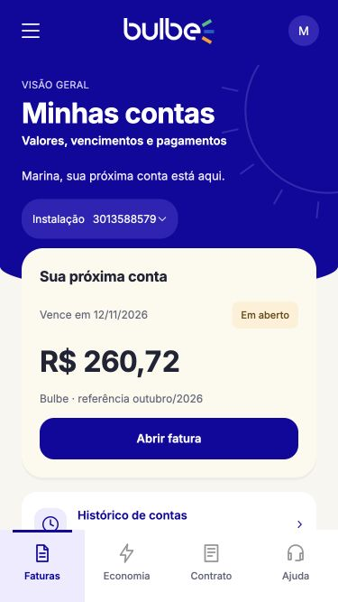
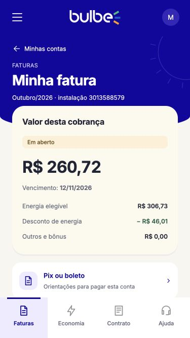
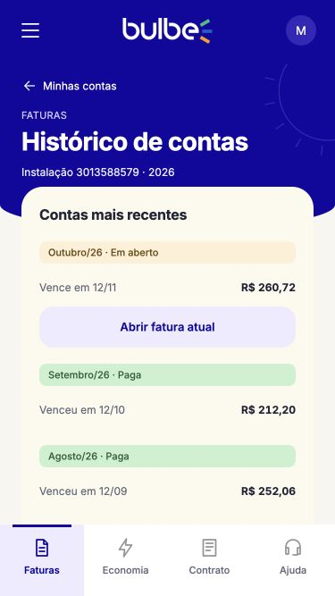

# HU02 — Minhas contas, Minha fatura e Histórico de contas

Responsável: Rafael Lombardi. Implementação em HTML, CSS e JavaScript puro, baseada nas três telas HU02 do [Figma do grupo](https://www.figma.com/design/2cpDUnDzNM7nVFdlHso0Ci/Bulbe---Squad-03---Wireframes?node-id=103-197).

## Executar

Para visualizar por duplo clique, abra `index.html` da pasta extraída do ZIP, ou `assets/telas/contas.html`. O index do pacote é um atalho para Minhas contas; o index compartilhado do repositório é preservado. A prévia local usa os mesmos dados fictícios incorporados em um script clássico.

Para trabalhar no projeto, abra a raiz no VS Code. Use **Open with Live Server** em `assets/telas/contas.html`, ou execute `python3 -m http.server 8772` na raiz e abra `http://localhost:8772/assets/telas/contas.html`.

Com Live Server, as páginas continuam usando `api.js` e `fetch` para ler os arquivos JSON. A abertura direta usa `hu02-offline.js`, gerado das mesmas fontes e dos mesmos JSONs, sem depender de servidor. Não há instalação de dependências. Após alterar dados ou lógica, execute `python3 scripts/gerar-demo-hu02.py` para atualizar a demonstração; use `--check` para verificar se está sincronizada.

## Arquivos

- `assets/telas/contas.html`: visão geral, próxima conta, instalação e atalhos.
- `assets/telas/fatura.html`: conta selecionada, valor, situação, vencimento e detalhamento disponível.
- `assets/telas/historico.html`: contas emitidas, valores e situações; previsões ficam em uma seção separada.
- `assets/css/hu02.css`: somente os estilos do conteúdo da HU02.
- `assets/js/hu02-loader.js`: escolhe o modo local ou com servidor e informa uma falha de inicialização.
- `assets/js/hu02-offline.js`: demonstração gerada automaticamente para abertura por duplo clique.
- `assets/js/hu02.js`: carrega dados pela API existente, renderiza conteúdo e conecta navegação.
- `assets/js/hu02-model.js`: regras de situação, ordenação e formatação.
- `data/faturas.json`: quatro contas fictícias do Figma para Marina. A estimativa anterior (ID 102) foi deslocada para novembro para não duplicar a referência da cobrança emitida de outubro. A conta do outro cliente foi preservada.
- `tests/hu02-model.test.mjs`: testes das regras, executáveis com `node --test tests/hu02-model.test.mjs`.

## Uso do template

As três páginas carregam `app-template.js` e usam `<bulbe-app profile-initial="M" active-area="faturas">`. Logo, menus, fonte Inter e comportamento do menu lateral são os arquivos compartilhados originais. Nenhum arquivo do template foi alterado. A moldura usa `iphone-se-preview.css`, com 375 × 667 px no computador; até 430 px ocupa a janela. Cabeçalho e abas ficam fora da rolagem do conteúdo.

Título, saudação, seletor de instalação, fundo azul com sol, cards e links de retorno pertencem ao conteúdo da HU02. O retorno das telas internas fica dentro do conteúdo, mantendo a barra de 72 px do componente. O card se sobrepõe ao fundo azul, como no Figma.

## Comportamento e dados

O cliente padrão é Marina (ID 1). O parâmetro `?cliente=2` demonstra outra pessoa e `?cliente=3` demonstra lista vazia. A seleção é simulada e não substitui autenticação. A API filtra pelo cliente e os detalhes são procurados apenas nessa lista, respeitando a instalação selecionada.

Contas em aberto passam a vencidas quando o vencimento é anterior à data local de consulta. Uma previsão nunca oferece pagamento. Uma conta paga permanece paga. Enquanto o JSON é lido, há mensagem de carregamento; se falhar, há explicação e botão de nova tentativa.

O histórico possui links para cada conta. A previsão continua identificada como estimativa. Os valores, a instalação e a identidade são fictícios. A opção Pix ou boleto abre apenas orientações do protótipo: não gera códigos nem realiza pagamentos.

## Integração com as outras HUs

`bulbe:navigate` é tratado em `hu02.js`. Faturas leva a `contas.html`. Os destinos das outras áreas ficam centralizados no objeto `destinos`. Quando os integrantes entregarem as páginas, acrescentar seus caminhos ali. Enquanto não existem, o protótipo explica que a área ainda será conectada e mantém Faturas selecionada, sem navegar para URLs inexistentes.

O `index.html` do projeto inclui um link para a HU02.

## Validação realizada

- Seis testes automatizados aprovados para vencimento, previsão, ordenação, formatação e valores.
- Navegação Minhas contas → Minha fatura → Histórico e abertura de contas pagas e previstas.
- Menu por teclado; Escape fecha e devolve o foco ao botão de abertura.
- Estados de carregamento, erro HTTP simulado e recuperação pelo botão Tentar novamente.
- Lista vazia, cliente diferente e fatura que não pertence ao cliente selecionado.
- Layout em 375 e 320 px, sem rolagem horizontal; controles do conteúdo com pelo menos 44 px.
- Prévia no computador com moldura do template; capturas móveis em [`hu02/`](hu02/).

A demonstração gerada foi validada com os três HTMLs e sem leitura de JSON; o fluxo HTTP com a API também foi verificado. A validação visual do script de demonstração foi feita via HTTP; a execução no protocolo `file:` não foi inspecionada visualmente.

## Prévias

| Minhas contas | Minha fatura | Histórico de contas |
| --- | --- | --- |
|  |  |  |
