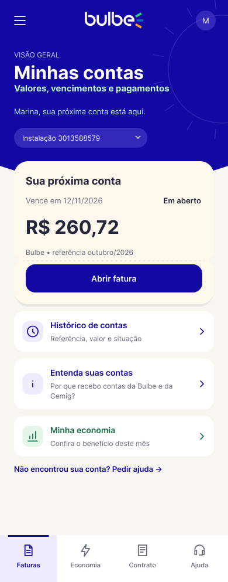

# HU02: Encontrar e consultar as contas

**Responsável:** Rafael Lombardi.

**Persona:** [Marina](../personas/persona-integrante-2.md).

**História:** [HU02](../../historias/historia-integrante-2.md).

**Jornada:** [Integrante 2](../jornadas/jornada-integrante-2.md).

## Dor e proposta

Marina precisa encontrar suas contas e consultar valor, vencimento e situação para organizar o pagamento.

As telas reúnem a próxima conta, seu detalhamento e o histórico. Os estados alternativos mostram ausência de fatura e fatura vencida.

**Indicador pretendido:** Pagamento da primeira fatura no prazo. A relação entre a proposta e a melhoria do indicador é uma hipótese a validar com clientes.

## Telas da Sprint II

Exportações completas dos quadros do novo arquivo Figma. Cada imagem preserva as proporções da tela e o conteúdo disponível no quadro.

| Tela | Imagem | Figma | Dimensões PNG |
| --- | --- | --- | --- |
| Minhas contas | [hu02-minhas-contas.png](hu02-minhas-contas.png) | [Abrir tela](https://www.figma.com/design/2cpDUnDzNM7nVFdlHso0Ci/Bulbe---Squad-03---Wireframes?node-id=103-197) | 390 × 993 px |
| Minha fatura | [hu02-minha-fatura.png](hu02-minha-fatura.png) | [Abrir tela](https://www.figma.com/design/2cpDUnDzNM7nVFdlHso0Ci/Bulbe---Squad-03---Wireframes?node-id=103-1013) | 390 × 1185 px |
| Histórico de contas | [hu02-historico-de-contas.png](hu02-historico-de-contas.png) | [Abrir tela](https://www.figma.com/design/2cpDUnDzNM7nVFdlHso0Ci/Bulbe---Squad-03---Wireframes?node-id=103-1119) | 390 × 900 px |
| Sua conta ainda não chegou | [hu02-conta-ainda-nao-chegou.png](hu02-conta-ainda-nao-chegou.png) | [Abrir tela](https://www.figma.com/design/2cpDUnDzNM7nVFdlHso0Ci/Bulbe---Squad-03---Wireframes?node-id=103-1547) | 390 × 900 px |
| Fatura vencida | [hu02-fatura-vencida.png](hu02-fatura-vencida.png) | [Abrir tela](https://www.figma.com/design/2cpDUnDzNM7nVFdlHso0Ci/Bulbe---Squad-03---Wireframes?node-id=103-1619) | 390 × 918 px |

## Navegação

O [menu lateral](geral-menu-lateral.png) reúne os acessos às áreas do aplicativo. As telas de detalhe e os estados alternativos desta HU estão relacionados na tabela acima.

## Limites

Estas imagens são wireframes estáticos. A exportação não comprova navegação funcional, integração com sistemas, pagamento real ou atendimento real.

Os nomes, valores, datas e protocolos são exemplos fictícios para demonstração. Condições contratuais e canais oficiais precisam de confirmação antes do uso real.

A validação e a implementação dos estados previstos na história continuam sujeitas aos critérios de aceite da HU. As imagens não comprovam melhoria dos indicadores.
