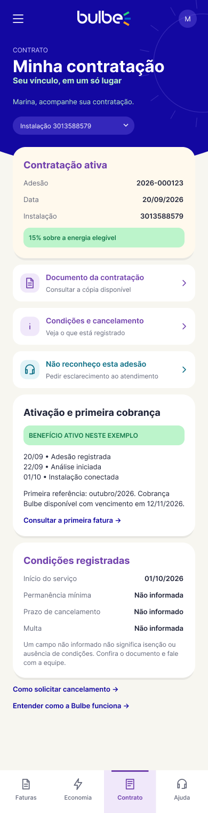

# HU03: Consultar a contratação

**Responsável:** Rhuan Matavellhe.

**Persona:** [Rafael](../personas/persona-integrante-3.md).

**História:** [HU03](../../historias/historia-integrante-3.md).

**Jornada:** [Integrante 3](../jornadas/jornada-integrante-3.md).

## Dor e proposta

Rafael quer confirmar o serviço associado a ele e esclarecer dúvidas sobre seu vínculo com a Bulbe.

As telas apresentam identificação da adesão, benefício, condições registradas e documento ilustrativo. Dados contratuais não informados aparecem como indisponíveis.

**Indicador pretendido:** Churn do primeiro mês. A relação entre a proposta e a melhoria do indicador é uma hipótese a validar com clientes.

## Telas da Sprint II

Exportações completas dos quadros do novo arquivo Figma. Cada imagem preserva as proporções da tela e o conteúdo disponível no quadro.

| Tela | Imagem | Figma | Dimensões PNG |
| --- | --- | --- | --- |
| Minha contratação | [hu03-minha-contratacao.png](hu03-minha-contratacao.png) | [Abrir tela](https://www.figma.com/design/2cpDUnDzNM7nVFdlHso0Ci/Bulbe---Squad-03---Wireframes?node-id=103-402) | 390 × 1521 px |
| Meu documento | [hu03-meu-documento.png](hu03-meu-documento.png) | [Abrir tela](https://www.figma.com/design/2cpDUnDzNM7nVFdlHso0Ci/Bulbe---Squad-03---Wireframes?node-id=103-1312) | 390 × 900 px |

## Navegação

O [menu lateral](geral-menu-lateral.png) reúne os acessos às áreas do aplicativo. As telas de detalhe e os estados alternativos desta HU estão relacionados na tabela acima.

## Limites

Estas imagens são wireframes estáticos. A exportação não comprova navegação funcional, integração com sistemas, pagamento real ou atendimento real.

Os nomes, valores, datas e protocolos são exemplos fictícios para demonstração. Condições contratuais e canais oficiais precisam de confirmação antes do uso real.

A validação e a implementação dos estados previstos na história continuam sujeitas aos critérios de aceite da HU. As imagens não comprovam melhoria dos indicadores.
