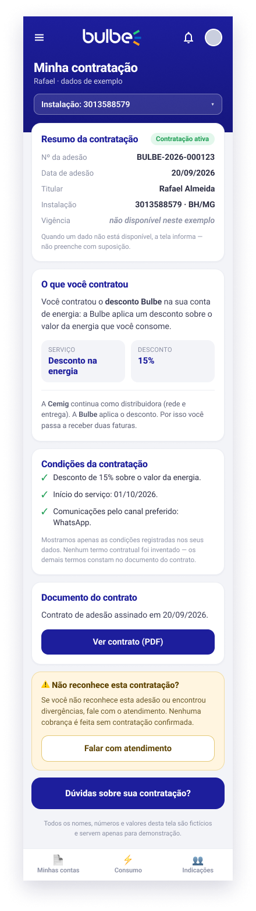

# HU03 — Minha contratação

**Responsável:** Rhuan ([@MdRhuan](https://github.com/MdRhuan)).  
**História:** [HU03](../../historias/historia-integrante-3.md).  
**Persona:** [Rafael](../personas/persona-integrante-3.md).  
**Jornada:** [Integrante 3](../jornadas/jornada-integrante-3.md), etapas “Adesão” e “Acompanhamento”, com a confirmação do vínculo na “Primeira fatura”.

Exportação PNG da tela de 440 × 1556 px. Nomes, números, datas e valores são exemplos fictícios, como indicado na própria tela.

## Dor e proposta

Rafael é um cliente cauteloso: antes de confiar plenamente na Bulbe, quer confirmar qual serviço está associado a ele e esclarecer dúvidas sobre o seu vínculo com a empresa. A tela “Minha contratação” reúne:

- resumo da contratação, com a identificação da adesão/contrato e a data de adesão (exemplo: 20/09/2026);
- explicação em linguagem simples do que foi contratado, incluindo o desconto na energia (exemplo: 15%);
- condições de contratação (permanência e cancelamento);
- acesso ao documento contratual, pelo botão “Ver contrato (PDF)”;
- aviso destacado “Não reconhece esta contratação?”, com orientação para procurar atendimento;
- acesso a “Dúvidas sobre minha contratação”.

O indicador pretendido é o churn do 1º mês. A hipótese é que mais transparência sobre a empresa e as condições de contratação aumente a confiança do cliente. A inadimplência de 32,4% apresentada no roteiro motiva a investigação; a imagem não comprova melhoria do indicador nem redução de churn.

## Navegação prevista

- Entrada: navegação do aplicativo → Minha contratação.
- “Ver contrato (PDF)”: abrir o documento contratual, quando disponível.
- “Não reconhece esta contratação?” / “Dúvidas sobre minha contratação”: orientação e acesso a atendimento → HU06. Os destinos finais serão combinados pelo squad.
- A tela deve oferecer retorno ao início.

## Limites desta entrega

Wireframe estático da tela principal, sem protótipo clicável, sem PDF real e sem atendimento real. A imagem representa uma contratação de exemplo com dados fictícios. Os estados previstos nos critérios da história — informação de contratação indisponível, documento contratual ausente, dado faltante sinalizado como limitação, além de carregamento e erro — deverão ser detalhados/implementados na Sprint 2. A apresentação e o registro da Sprint Review I serão realizados pelo squad; esta publicação não afirma que já aconteceram.
