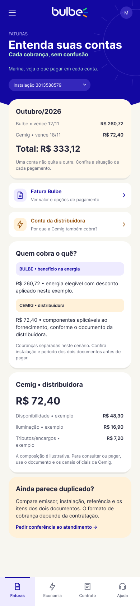

# HU05: Entender as contas da Cemig e da Bulbe

**Responsável:** Marcio Filho.

**Persona:** [André](../personas/persona-integrante-5.md).

**História:** [HU05](../../historias/historia-integrante-5.md).

**Jornada:** [Integrante 5](../jornadas/jornada-integrante-5.md).

## Dor e proposta

André recebe duas faturas e teme pagar duas vezes ou deixar uma cobrança em aberto.

A tela separa valores e vencimentos da Bulbe e da Cemig, explica o papel de cada empresa e orienta a conferência em caso de aparente duplicidade.

**Indicador pretendido:** Percentual de inadimplência na primeira fatura e dúvidas sobre cobrança. A relação entre a proposta e a melhoria do indicador é uma hipótese a validar com clientes.

## Telas da Sprint II

Exportações completas dos quadros do novo arquivo Figma. Cada imagem preserva as proporções da tela e o conteúdo disponível no quadro.

| Tela | Imagem | Figma | Dimensões PNG |
| --- | --- | --- | --- |
| Entenda suas contas | [hu05-contas-cemig-bulbe.png](hu05-contas-cemig-bulbe.png) | [Abrir tela](https://www.figma.com/design/2cpDUnDzNM7nVFdlHso0Ci/Bulbe---Squad-03---Wireframes?node-id=103-652) | 390 × 1678 px |

## Navegação

O [menu lateral](geral-menu-lateral.png) reúne os acessos às áreas do aplicativo. As telas de detalhe e os estados alternativos desta HU estão relacionados na tabela acima.

## Limites

Estas imagens são wireframes estáticos. A exportação não comprova navegação funcional, integração com sistemas, pagamento real ou atendimento real.

Os nomes, valores, datas e protocolos são exemplos fictícios para demonstração. Condições contratuais e canais oficiais precisam de confirmação antes do uso real.

A validação e a implementação dos estados previstos na história continuam sujeitas aos critérios de aceite da HU. As imagens não comprovam melhoria dos indicadores.
