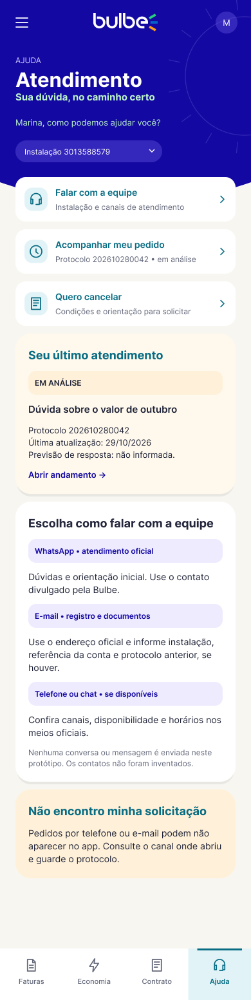

# HU06: Encontrar atendimento e acompanhar solicitações

**Responsável:** Caio Campos.

**Persona:** [Sônia](../personas/persona-integrante-6.md).

**História:** [HU06](../../historias/historia-integrante-6.md).

**Jornada:** [Integrante 6](../jornadas/jornada-integrante-6.md).

## Dor e proposta

Sônia precisa encontrar o canal adequado e acompanhar sua solicitação, sem perder o protocolo ou receber informações de andamento inventadas.

As telas mostram canais, protocolo e eventos registrados. Incluem cancelamento, ausência de solicitações e indisponibilidade de consulta.

**Indicador pretendido:** Churn do primeiro mês. A relação entre a proposta e a melhoria do indicador é uma hipótese a validar com clientes.

## Telas da Sprint II

Exportações completas dos quadros do novo arquivo Figma. Cada imagem preserva as proporções da tela e o conteúdo disponível no quadro.

| Tela | Imagem | Figma | Dimensões PNG |
| --- | --- | --- | --- |
| Atendimento | [hu06-atendimento.png](hu06-atendimento.png) | [Abrir tela](https://www.figma.com/design/2cpDUnDzNM7nVFdlHso0Ci/Bulbe---Squad-03---Wireframes?node-id=103-768) | 390 × 1553 px |
| Minha solicitação | [hu06-detalhe-solicitacao.png](hu06-detalhe-solicitacao.png) | [Abrir tela](https://www.figma.com/design/2cpDUnDzNM7nVFdlHso0Ci/Bulbe---Squad-03---Wireframes?node-id=103-1384) | 390 × 998 px |
| Cancelar assinatura | [hu06-como-cancelar.png](hu06-como-cancelar.png) | [Abrir tela](https://www.figma.com/design/2cpDUnDzNM7nVFdlHso0Ci/Bulbe---Squad-03---Wireframes?node-id=103-1464) | 390 × 1001 px |
| Atendimento sem solicitações | [hu06-atendimento-sem-solicitacoes.png](hu06-atendimento-sem-solicitacoes.png) | [Abrir tela](https://www.figma.com/design/2cpDUnDzNM7nVFdlHso0Ci/Bulbe---Squad-03---Wireframes?node-id=103-1759) | 390 × 1333 px |
| Andamento indisponível | [hu06-detalhe-indisponivel.png](hu06-detalhe-indisponivel.png) | [Abrir tela](https://www.figma.com/design/2cpDUnDzNM7nVFdlHso0Ci/Bulbe---Squad-03---Wireframes?node-id=103-1854) | 390 × 900 px |

## Navegação

O [menu lateral](geral-menu-lateral.png) reúne os acessos às áreas do aplicativo. As telas de detalhe e os estados alternativos desta HU estão relacionados na tabela acima.

## Limites

Estas imagens são wireframes estáticos. A exportação não comprova navegação funcional, integração com sistemas, pagamento real ou atendimento real.

Os nomes, valores, datas e protocolos são exemplos fictícios para demonstração. Condições contratuais e canais oficiais precisam de confirmação antes do uso real.

A validação e a implementação dos estados previstos na história continuam sujeitas aos critérios de aceite da HU. As imagens não comprovam melhoria dos indicadores.
